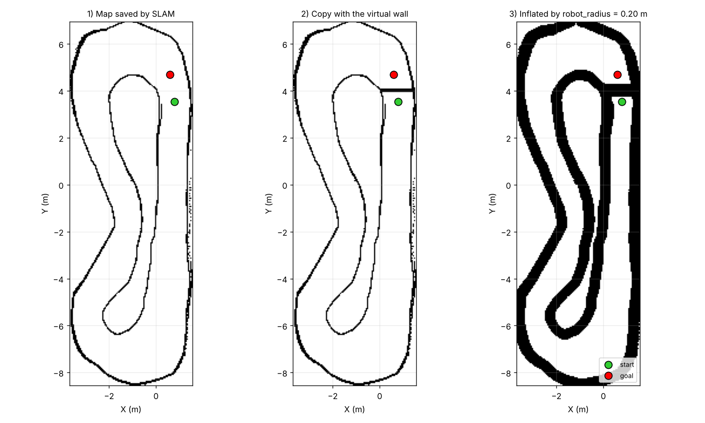
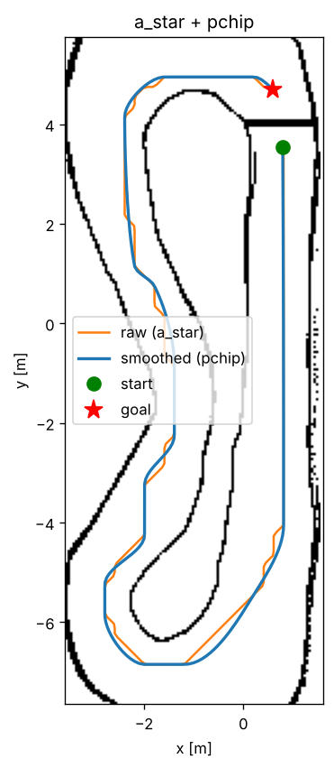
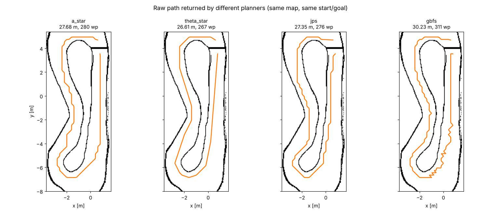
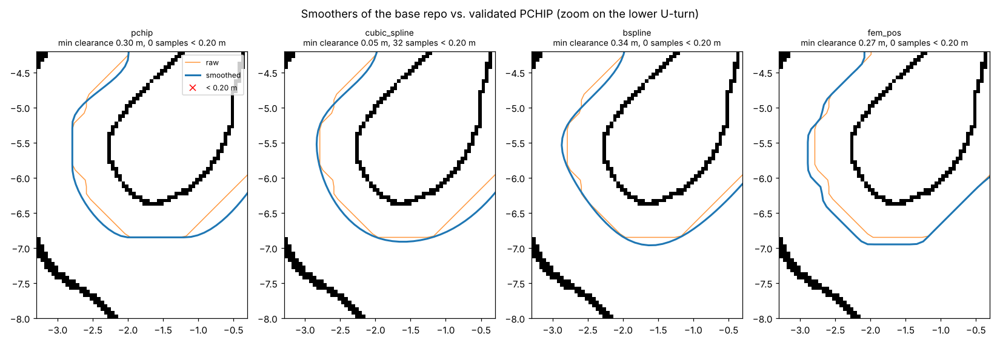
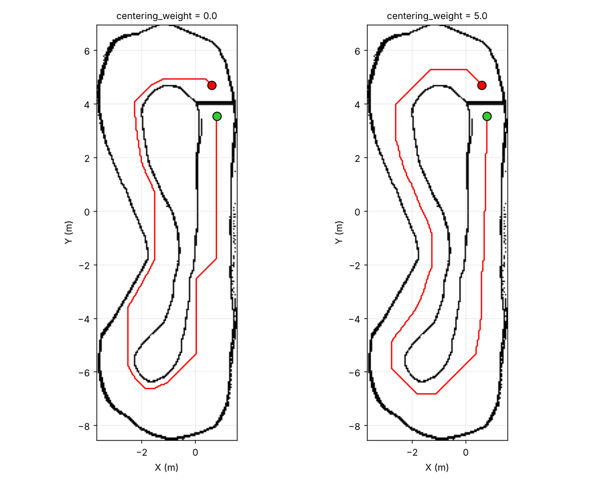
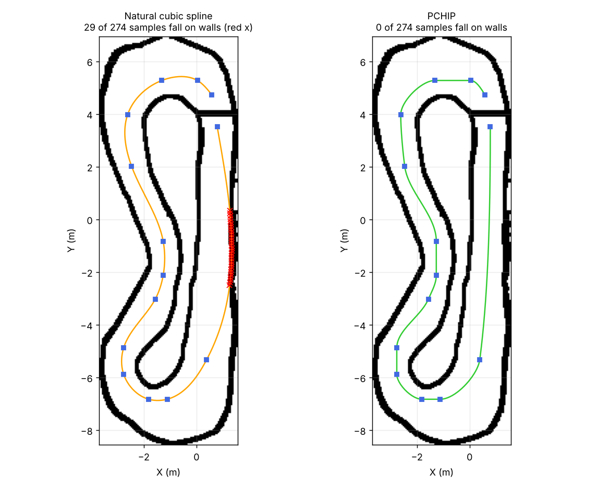

# Tutorial 5: F1TENTH Global Path Planning in AutoDRIVE: Adapting the Base Repository

## Project Description

This laboratory generates and smooths a **global trajectory** for an F1TENTH vehicle using the map built with SLAM in the previous laboratory and the **base repository provided by the instructor**, [`widegonz/Global_Planner`](https://github.com/widegonz/Global_Planner).

Unlike Follow the Gap (Tutorial 4), which reacts to the current LiDAR scan, a global planner uses a **previously saved map** to compute a complete route from a start point to a goal point before the vehicle moves. The scope of this laboratory is **only the generation and smoothing of the trajectory**, not the controller that follows it.

The base repository already contains many planning algorithms. Each student receives a **different algorithm**, so this tutorial does not depend on one planner. The workflow is the same for all of them:

1. Clone the base repository.
2. Prepare **your own map** (the one saved in Tutorial 3) and a start and goal on it.
3. Run **your assigned planner** by its name (`a_star`, `dijkstra`, `theta_star`, ...).
4. **Smooth** the raw path with a smoother of the repository or with a validated PCHIP spline.
5. Check the result against the map and export it to CSV.
6. Visualize the raw and smoothed paths in RViz2.

At the end, the Appendix shows one complete adaptation as an example: a ROS 2 Dijkstra planner with a wall-avoidance cost and a PCHIP smoother.

## Learning Objectives

After completing this laboratory, students should be able to:

- Explain the difference between global planning and reactive navigation.
- Understand how a saved map becomes a grid that a search algorithm can use.
- Adapt a base repository to a new map: coordinates, resolution, downsampling, and obstacle inflation.
- Run any planner of the base repository by its name and compare it with other planners.
- Explain why a raw grid path must be smoothed and compare different smoothers.
- Validate a trajectory against the map (clearance to the obstacles).
- Export the trajectory as waypoints and visualize it in RViz2.

# 1. Prerequisites

This tutorial assumes that the AutoDRIVE simulator, its ROS 2 bridge, and the SLAM map were configured in the previous laboratories.

Required software and material:

- Ubuntu 22.04.
- ROS 2 Humble (only for the RViz2 visualization, Section 9).
- AutoDRIVE workspace at `~/autodrive_ws` (<a href="./Tutorial 1: AutoDrive Installation and Setup.md">Tutorial 1</a>).
- The map of the circuit saved with SLAM Toolbox, `.pgm` + `.yaml` (<a href="./Tutorial 3: Simultaneous Localization and Maping.md">Tutorial 3</a>). This laboratory does **not** include a map: the planner uses the map **you** built, stored by default in `~/autodrive_ws/maps/` as `F1tenth_Map.pgm` and `F1tenth_Map.yaml`.
- Git.
- Python 3.10 with `venv`.

Install the system tools:

```bash
sudo apt update

sudo apt install -y \
  git \
  python3-venv \
  ros-humble-nav2-map-server \
  ros-humble-nav2-lifecycle-manager \
  ros-humble-diagnostic-updater \
  ros-humble-rviz2
```

# 2. Create a Python Environment for the Planners

The base repository needs libraries (`opencv-python`, `osqp`, `cvxopt`, ...) that are not part of the AutoDRIVE environment. Use a **separate** virtual environment so the AutoDRIVE one is not modified:

```bash
python3 -m venv ~/planner_venv
source ~/planner_venv/bin/activate

python -m pip install --upgrade pip setuptools wheel
```

The planning scripts of this laboratory do not need ROS, so this environment is enough until Section 9.

# 3. Download the Projects

This laboratory uses two repositories.

## 3.1 The Base Repository (instructor)

```bash
cd ~
git clone https://github.com/widegonz/Global_Planner.git

source ~/planner_venv/bin/activate
python -m pip install -r ~/Global_Planner/requirements.txt
```

> `requirements.txt` also installs the documentation tools (`mkdocs`, ...). If you want a lighter installation, install only what the planners use:
>
> ```bash
> python -m pip install numpy scipy matplotlib cvxopt osqp tqdm pyyaml typeguard opencv-python
> ```

Check the installation:

```bash
cd ~/Global_Planner
python -c "from python_motion_planning.utils import SearchFactory, CurveFactory; print('base repo OK')"
```

## 3.2 The Tutorial Project

The course repository contains tutorials and additional projects, but this laboratory only requires:

```text
f1tenth-global-planner-autodrive/
```

Git does not provide a normal `git clone` command for a single subdirectory. The following procedure uses a temporary **non-cone sparse checkout**, extracts only the required folder, and then removes the temporary repository.

> Run this procedure only if `~/autodrive_ws/src/f1tenth-global-planner-autodrive` does not already exist.

```bash
cd ~/autodrive_ws/src

git clone \
  --depth 1 \
  --filter=blob:none \
  --no-checkout \
  https://github.com/nabihandres/AUTODRIVE.git \
  .autodrive_sparse

cd .autodrive_sparse

git sparse-checkout init --no-cone
git sparse-checkout set '/f1tenth-global-planner-autodrive/**'
git checkout main

cd ~/autodrive_ws/src

mv \
  .autodrive_sparse/f1tenth-global-planner-autodrive \
  ./f1tenth-global-planner-autodrive

rm -rf .autodrive_sparse
```

Expected structure:

```text
~/autodrive_ws/src/
└── f1tenth-global-planner-autodrive/
    ├── docs/                         # Figures used by this tutorial
    ├── scripts/                      # Tools that run WITHOUT ROS
    │   ├── visualize_map.py          # Map with a coordinate grid
    │   ├── add_virtual_wall.py       # Wall on a copy of the map
    │   ├── pick_start_goal.py        # Click the start and the goal
    │   ├── plan_and_smooth.py        # Planner + smoother by name -> CSV
    │   └── plot_waypoints.py         # Draw any CSV path over the map
    └── f1tenth_global_planner/       # ROS 2 package (ament_python)
        ├── package.xml
        ├── setup.py
        ├── f1tenth_global_planner/
        │   ├── path_viewer_node.py   # Publishes any CSV path for RViz2
        │   ├── global_planner_node.py   # Appendix example (Dijkstra)
        │   └── path_smoother_node.py    # Appendix example (PCHIP)
        └── launch/
            ├── view_paths_launch.py  # map + CSV paths + RViz2
            ├── map_launch.py
            └── planning_launch.py    # Appendix example
```

Only the folder with `package.xml` is a ROS 2 package. `colcon` ignores `scripts/` and `docs/`. The figures in `docs/` were generated with the author's map.

# 4. The Base Repository

Inside `~/Global_Planner` the relevant parts are:

```text
Global_Planner/
├── python_motion_planning/
│   ├── global_planner/          # The planners (graph search, sample search, ...)
│   ├── curve_generation/        # The smoothers / curves
│   └── utils/planner/           # SearchFactory and CurveFactory
├── f1tenth/
│   ├── f1tenth_map.py           # load_map, grid_from_map, world_to_map, save_path_as_csv
│   └── control.py               # Same helpers + a controller example (not used here)
└── Mapas-F1Tenth/               # Example map of the instructor
```

## 4.1 Factories: Choose an Algorithm by Name

Every planner is created by name with `SearchFactory`, and every curve with `CurveFactory`:

```python
from python_motion_planning.utils import SearchFactory

planner = SearchFactory()("a_star", start=start, goal=goal, env=env)
cost, path, expand = planner.plan()
```

Changing the algorithm only means changing the string. This is why the same procedure works for every student.

## 4.2 From the Map to the Grid

`f1tenth/f1tenth_map.py` converts a saved map into the grid used by the planners:

| Function | What it does |
|---|---|
| `load_map(yaml, downsample_factor)` | Reads the `.yaml` and its image, marks as occupied every pixel darker than `0.45 × 255`, and **reduces the resolution** by `downsample_factor`. Returns `map_bin`, `resolution`, `origin`. |
| `grid_from_map(map_bin)` | Builds the `Grid` environment (set of obstacle cells) the planners need. |
| `world_to_map(x, y, resolution, origin)` | World coordinates in meters → cell `(ix, iy)`. |
| `map_to_world(ix, iy, ...)` | Cell → world coordinates (the **corner** of the cell). |
| `save_path_as_csv(...)` | Writes the path as `x,y`. |

Important points when you adapt it to your own map:

- **The planner works in cells, not meters.** The path it returns is a list of cells ordered from the goal to the start (for A\*). Convert it to meters and reverse it.
- **`downsample_factor` changes the cell size.** With a map of `0.05 m/cell` and factor `4`, every cell is `0.20 m`. A larger factor is faster but loses narrow corridors and thin walls (Section 5.3).
- **The base repository does not inflate obstacles by the size of the robot.** Without inflation, a path can pass a few centimeters from a wall.
- `map_to_world` returns the corner of the cell; the center is half a cell further. `plan_and_smooth.py` uses the center.
- Unknown space (the gray area of the SLAM map) is treated as free.

`scripts/plan_and_smooth.py` of this project wraps all of this, so you only choose the algorithms by name and read a report.

# 5. Prepare Your Map, Start and Goal

## 5.1 Create the Map Copy and Pick the Points

The planner needs two things that depend on **your** map:

1. A copy of the map with a **virtual wall** across the track (explained in Section 5.2).
2. A valid **start** and **goal**, one on each side of that wall.

Both steps are done with offline scripts that do not need ROS. Run them in the planner environment:

```bash
source ~/planner_venv/bin/activate

cd ~/autodrive_ws/src/f1tenth-global-planner-autodrive
```

### Step 1 — Read the coordinates of the map

```bash
python scripts/visualize_map.py \
  ~/autodrive_ws/maps/F1tenth_Map.yaml \
  -o ~/autodrive_ws/maps/map_with_grid.png
```

Open `map_with_grid.png`. It shows your map with a coordinate grid in meters. Locate the **start line** of the circuit and write down the `(x, y)` coordinates of the two borders of the track at that line, one at each end.

### Step 2 — Draw the virtual wall on a copy of the map

```bash
python scripts/add_virtual_wall.py \
  ~/autodrive_ws/maps/F1tenth_Map.yaml \
  --p1 X1 Y1 --p2 X2 Y2
```

Replace `(X1, Y1)` and `(X2, Y2)` with the two ends of the wall. The wall must go **from one border of the track to the other**, so that it completely closes the corridor.

For the author's map, the track is closed at `y = 4.05 m`:

```bash
python scripts/add_virtual_wall.py \
  ~/autodrive_ws/maps/F1tenth_Map.yaml \
  --p1 0.0 4.05 --p2 1.5 4.05
```

The script creates the following files next to the original map:

```text
~/autodrive_ws/maps/F1tenth_Map_walled.pgm
~/autodrive_ws/maps/F1tenth_Map_walled.yaml
```

The original map is never modified, and the script refuses to overwrite it. If the script prints a `WARNING: ... is outside the map`, one of the two ends is outside the area covered by the map: check the coordinates of Step 1.

### Step 3 — Choose the start and the goal

```bash
python scripts/pick_start_goal.py \
  ~/autodrive_ws/maps/F1tenth_Map_walled.yaml \
  --radius 0.20
```

A window opens with the **inflated** map (the same one the planner will use):

1. Click **once** for the **start**, on one side of the wall.
2. Click **once** for the **goal**, on the other side of the wall.
3. The terminal reports whether each point is free:

```text
--- Result ---
START: x=0.792, y=3.535  ->  FREE
GOAL: x=0.600, y=4.701  ->  FREE
```

Both points must be `FREE`. Write down the four coordinates: they are the start and goal of the next section. The values above belong to the author's map.

> The start should be where the vehicle appears in the simulator, so that the planned route and the real vehicle match in Section 9.3.


## 5.2 Why a Virtual Wall?

The circuit is a **closed loop**. The start and the goal are placed on both sides of the starting line, close to each other (about `1.2 m` apart in the author's map). Without any change, the shortest route between them is a short hop, not a lap.

To force the planner to go all the way around, a **copy** of the map is edited and a short wall is drawn across the track, between the start and the goal (Step 2 above):

```text
F1tenth_Map.pgm          → map saved by SLAM (unchanged)
F1tenth_Map_walled.pgm   → copy with a wall at the start/goal line (add_virtual_wall.py)
```



- The wall exists **only in the image**. It does not exist in the simulator, so the vehicle can cross that line physically.
- Keep the original map. It is the raw evidence of the SLAM result.
- Obstacle inflation (third panel) grows every obstacle by the radius of the robot so that a point-like planner keeps the real vehicle away from the walls. The simulated vehicle has its wheels about `0.118 m` from its center line, so `0.20 m` leaves a margin.

## 5.3 Downsampling Can Break the Wall

The base `load_map` reduces the resolution. A thin wall can disappear when several pixels are merged. On the author's map, with the same start and goal (A\*, `--inflate`):

| `--factor` | Cell size | Raw points | Result |
|---:|---:|---:|---|
| `1` | 0.05 m | 490 | Goes around the circuit (26.2 m) |
| `2` | 0.10 m | 101 | **Leaks through the wall**: short hop (11.5 m) |
| `4` | 0.20 m | 128 | Goes around the circuit (27.7 m) |
| `8` | 0.40 m | 4 | **Leaks through the wall**: short hop (1.3 m) |

If the length of your route is only a few meters, the planner crossed the wall. `--factor 1` and `4` worked on the author's map. A thicker wall (`add_virtual_wall.py --thickness 0.25`) fixed factor `8` in our test but **not** factor `2`. Always compare the length of the route with the size of the circuit.

# 6. Run Your Assigned Planner

Activate the planner environment and go to the tutorial project:

```bash
source ~/planner_venv/bin/activate

cd ~/autodrive_ws/src/f1tenth-global-planner-autodrive
```

Run the whole pipeline with one command. The values of the example belong to the author's map; use the start and goal you obtained in Section 5:

```bash
python scripts/plan_and_smooth.py \
  ~/autodrive_ws/maps/F1tenth_Map_walled.yaml \
  --repo ~/Global_Planner \
  --start 0.792 3.535 --goal 0.600 4.701 \
  --planner a_star \
  --smoother pchip \
  --factor 4 --inflate \
  --out-dir ~/autodrive_ws/waypoints
```

Replace `a_star` with **your assigned algorithm**. The script prints the steps and a validation report (author's map):

```text
Grid 26x77, cell = 0.200 m, start cell (22, 60), goal cell (21, 66)
a_star: cost 139.4 cells, 128 raw points
--- validation on the full-resolution map ---
raw       points= 280  length= 27.68 m  min clearance=0.300 m  samples < 0.20 m: 0/280
smoothed  points= 277  length= 27.57 m  min clearance=0.300 m  samples < 0.20 m: 0/277
CSV files written to /home/<user>/autodrive_ws/waypoints
Overlay saved to /home/<user>/autodrive_ws/waypoints/path_overlay.png
```

What the report means:

- **points / length**: size of the path, resampled every `--step` meters (`0.10` by default).
- **min clearance**: distance from the path to the nearest obstacle in the **original, full-resolution map**. Values are multiples of the map resolution (`0.05 m`).
- **samples < 0.20 m**: how many points are closer to an obstacle than `--robot-radius`. For a usable trajectory this must be `0`.

Three files are written to `--out-dir`:

| File | Content |
|---|---|
| `raw_path.csv` | `x, y, yaw` of the planner path, resampled |
| `smoothed_path.csv` | `x, y, yaw` of the smoothed path |
| `path_overlay.png` | Map with both paths, start, and goal |



> The figure was generated with the author's map; yours will have a different shape.

[video3.webm](https://github.com/user-attachments/assets/758d5b0f-0fa2-4477-abcd-cd506af15612)


## 6.1 Options of `plan_and_smooth.py`

| Option | Default | Meaning |
|---|---:|---|
| `--repo` | (required) | Path of the cloned `Global_Planner` |
| `--start X Y`, `--goal X Y` | (required) | Start and goal in map coordinates (m) |
| `--planner` | `a_star` | Name of the planner in `SearchFactory` |
| `--smoother` | `pchip` | `none`, `pchip`, `cubic_spline`, `bspline`, `fem_pos` |
| `--factor` | `4` | Downsampling factor of `load_map` |
| `--inflate` | off | Inflate the obstacles by `--robot-radius` before planning |
| `--robot-radius` | `0.20` | Radius used to inflate and to validate (m) |
| `--simplify-epsilon` | `0.15` | Douglas-Peucker tolerance (m) |
| `--step` | `0.10` | Spacing of the exported waypoints (m) |
| `--fem-weights S L R` | `100 1 1` | Weights of `fem_pos` (smooth, length, reference) |
| `--fem-bound` | `0.10` | Maximum displacement of each point in `fem_pos` (m) |
| `--out-dir` | `waypoints` | Folder of the CSV files |

## 6.2 Which Planners Can I Use?

The script accepts the grid-based planners of `SearchFactory`. These results use the author's map, `--factor 4 --inflate`, and no smoothing:

| Planner (`--planner`) | Length | Min. clearance | Comment |
|---|---:|---:|---|
| `a_star` | 27.68 m | 0.30 m | Optimal on the grid |
| `dijkstra` | 27.74 m | 0.30 m | Same route as A\*, explores more cells |
| `gbfs` | 30.23 m | 0.28 m | Greedy: not optimal, irregular path |
| `jps` | 27.35 m | 0.21 m | Jump Point Search |
| `d_star` | 27.66 m | 0.25 m | Incremental replanning |
| `lpa_star` | 27.75 m | 0.30 m | Incremental replanning |
| `d_star_lite` | 27.66 m | 0.25 m | Incremental replanning |
| `theta_star` | 26.61 m | 0.30 m | Any-angle: fewer, longer segments |
| `lazy_theta_star` | 26.58 m | 0.25 m | Any-angle |
| `s_theta_star` | 26.65 m | 0.15 m | Any-angle, 2 samples closer than 0.20 m |



Notes:

- `voronoi`, `aco`, and `pso` are accepted by the script, but on this map they returned no path or crashed in our tests. If one of them is assigned to you, try `--factor 1`, lower the number of obstacles in the area, or consult the instructor.
- `anya` is listed in the factory of the repository but is **not implemented**.
- The sample-based planners (`rrt`, `rrt_connect`, `rrt_star`, `informed_rrt`) work on a continuous `Map` environment (rectangles and circles), not on a grid. `plan_and_smooth.py` does **not** cover them. They would need the obstacles of your map converted to rectangles or circles.
- Any-angle planners (`theta_star`, ...) already return few points with long straight segments. The smoother only rounds the corners.
- Your result can differ from the table because it depends on your map, your start and goal, and `--factor`.

# 7. Smooth the Trajectory

## 7.1 Why the Raw Path Must Be Smoothed

The raw path has one point per grid cell and changes direction in multiples of 45° (a staircase). A vehicle cannot follow it: its steering would change abruptly at every corner. A smoother replaces it with a continuous curve.

## 7.2 Smoothers

| `--smoother` | Origin | Idea |
|---|---|---|
| `none` | - | Raw path, only resampled |
| `pchip` | This project | Douglas-Peucker control points + shape-preserving PCHIP, checked against the map |
| `cubic_spline` | `CubicSpline` of the repository | Natural cubic spline through the same control points |
| `bspline` | `BSpline` of the repository | Cubic B-spline that interpolates the control points |
| `fem_pos` | `FemPosSmoother` of the repository | Optimization (OSQP): smoothness + length + closeness to the raw path |

The first three smoothers (`cubic_spline`, `bspline`, `pchip`) share a pre-processing: **Douglas-Peucker** keeps only the points needed to represent the shape within `--simplify-epsilon`. Here, the 128 raw points of A\* become a few control points, and the curve is fitted through them. `fem_pos` works on the dense path instead.

The `run()` methods of `CubicSpline` and `Bezier` in the repository only **plot** the curve and return nothing. `plan_and_smooth.py` calls their numerical parts (`CubicSpline.spline`, `BSpline.run(..., display=False)`, `FemPosSmoother.run(..., display=False)`) so that the result can be saved and validated.

## 7.3 Compare the Smoothers

Same planner (`a_star`), same map, `--factor 4 --inflate`:

| `--smoother` | Length | Min. clearance | Samples < 0.20 m |
|---|---:|---:|---:|
| `none` | 27.68 m | 0.30 m | 0 / 280 |
| `pchip` | 27.57 m | 0.30 m | 0 / 277 |
| `cubic_spline` | 27.75 m | 0.05 m | **32 / 279** |
| `bspline` | 27.56 m | 0.34 m | 0 / 277 |
| `fem_pos` | 28.14 m | 0.27 m | 0 / 283 |



The natural cubic spline is smooth but **overshoots** between control points that are far apart, and part of the curve ends up almost on the wall (min. clearance `0.05 m`; the zoom shows one U-turn, some of the 32 samples are outside it). PCHIP (*Piecewise Cubic Hermite Interpolating Polynomial*) is **shape-preserving**: it does not create new maxima or minima between two control points. The script also **validates** the PCHIP curve and, if a sample falls closer than `--robot-radius` to an obstacle, adds back raw points around it and fits again.

> **Always read the validation report.** A smoother can produce a nice-looking curve that crosses the wall. Run your assigned planner with at least two smoothers and keep the one with `0` invalid samples and the shortest length.

## 7.4 Tuning

- `--simplify-epsilon` (default `0.15`): larger values keep fewer control points and give smoother but less faithful curves. Smaller values follow the raw path more closely.
- `--robot-radius`: larger values keep the path farther from the walls, but the corridor may close. If the planner fails, try a smaller value.
- `--fem-weights`: raise `SMOOTH` for a smoother path, raise `REF` to stay closer to the raw path.
- `--factor`: smaller factors give a more precise route but are slower.

Plot any pair of CSV files over the map with:

```bash
python scripts/plot_waypoints.py \
  ~/autodrive_ws/maps/F1tenth_Map_walled.yaml \
  ~/autodrive_ws/waypoints/raw_path.csv \
  ~/autodrive_ws/waypoints/smoothed_path.csv \
  -o trajectory_overlay.png
```

# 8. Waypoints

Both CSV files have the columns `x, y, yaw`:

```text
x,y,yaw
0.7920,3.5350,-1.5708
0.7920,3.4350,-1.5708
...
```

- `x`, `y`: position in meters in the frame of the saved map.
- `yaw`: heading in radians (direction toward the next point).
- Consecutive points are `--step` meters apart.

Check the files:

```bash
head -4 ~/autodrive_ws/waypoints/smoothed_path.csv

wc -l ~/autodrive_ws/waypoints/raw_path.csv \
      ~/autodrive_ws/waypoints/smoothed_path.csv
```

`wc -l` reports one header line plus one line per point. This is the file a path-tracking controller (for example Pure Pursuit) would read.

# 9. Visualize the Trajectory in RViz2

## 9.1 Build the Viewer Package

The package `f1tenth_global_planner` contains `path_viewer_node`, which reads `raw_path.csv` and `smoothed_path.csv` and publishes them as `nav_msgs/Path`. It does not depend on the planner you used.

> If you have an old package with the same name from a previous project, move it out of `~/autodrive_ws/src` first. `colcon` fails when two packages have the same name.

```bash
cd ~/autodrive_ws

source /opt/ros/humble/setup.bash
source ~/autodrive_ws/venv/bin/activate
touch ~/autodrive_ws/venv/COLCON_IGNORE

colcon build --packages-select f1tenth_global_planner --symlink-install

source ~/autodrive_ws/install/setup.bash
ros2 pkg executables f1tenth_global_planner
```

The list must include `path_viewer_node`.

## 9.2 Run the Viewer

```bash
ros2 launch f1tenth_global_planner view_paths_launch.py \
  map_yaml:=$HOME/autodrive_ws/maps/F1tenth_Map_walled.yaml \
  waypoints_dir:=$HOME/autodrive_ws/waypoints
```

This launch file starts `map_server` and its lifecycle manager (your map), `path_viewer_node`, and `rviz2`. The viewer prints:

```text
[path_viewer_node]: Published 280 poses from /home/<user>/autodrive_ws/waypoints/raw_path.csv
[path_viewer_node]: Published 277 poses from /home/<user>/autodrive_ws/waypoints/smoothed_path.csv
```

Configure RViz2:

1. In the **Displays** panel (left), under **Global Options**, check that **Fixed Frame** is `map` (it is the default; if the drop-down does not list it, type `map`). A red `Frame [map] does not exist` status is normal here because no node publishes TF.
2. Add a **Map** display and set its topic to `/map`. Expand **Topic** and set **Durability Policy** to `Transient Local`.
3. Add a **Path** display with the topic `/raw_path` and a red color.
4. Add a second **Path** display with the topic `/smoothed_path` and a green color.
5. For **both** Path displays, expand **Topic** and set **Durability Policy** to `Transient Local`.

> The viewer publishes each path only once. A display with the default *Volatile* policy never receives it, and the path does not appear.

To see a new result, run `plan_and_smooth.py` again and then restart the launch file.

[video5.webm](https://github.com/user-attachments/assets/97b186c5-f9f3-4021-b95c-82d141824ef8)


## 9.3 Compare the Route with the Vehicle (Optional)

The AutoDRIVE bridge already publishes the transform `map → f1tenth_1` with the vehicle position, so the vehicle can be displayed over the planned path. No extra node is needed.

Close the previous launch (`Ctrl+C`) and run the following terminals in order.

### Terminal 1 — Start the AutoDRIVE Simulator

```bash
cd ~/Downloads/AutoDRIVE_Sim

./"AutoDRIVE Simulator.x86_64"
```

Load the F1TENTH scenario, activate the communication bridge, and wait until its status displays `Connected`.

### Terminal 2 — Start the AutoDRIVE Bridge

```bash
cd ~/autodrive_ws

source /opt/ros/humble/setup.bash
source ~/autodrive_ws/venv/bin/activate
source ~/autodrive_ws/install/setup.bash

ros2 launch autodrive_f1tenth simulator_bringup_headless.launch.py
```

### Terminal 3 — Show the Trajectory

```bash
cd ~/autodrive_ws

source /opt/ros/humble/setup.bash
source ~/autodrive_ws/venv/bin/activate
source ~/autodrive_ws/install/setup.bash

ros2 launch f1tenth_global_planner view_paths_launch.py \
  map_yaml:=$HOME/autodrive_ws/maps/F1tenth_Map_walled.yaml
```

In RViz2, keep the configuration of Section 9.2 and add:

- A **TF** display, to see the frame `f1tenth_1` (the vehicle) moving over the map.
- Optionally, a **LaserScan** display with the topic `/autodrive/f1tenth_1/lidar`, to check that the scan lies on top of the walls of the map.

### Terminal 4 — Drive Manually (optional)

```bash
cd ~/autodrive_ws

source /opt/ros/humble/setup.bash
source ~/autodrive_ws/venv/bin/activate
source ~/autodrive_ws/install/setup.bash

ros2 run autodrive_f1tenth teleop_keyboard
```

Drive along the circuit and compare the vehicle with the green path.

To check that the start of the route matches the real position of the vehicle at spawn, compare:

```bash
ros2 topic echo /autodrive/f1tenth_1/ips --once
```

with the start you used in Section 6.

> The planned path is expressed in the frame of the saved map. With the SLAM parameters of Tutorial 3, that map starts aligned with the AutoDRIVE `map` frame, so the path should overlap the vehicle, but a small shift caused by SLAM drift is possible.

> Do not restart the simulator while the planner or the bridge are running. Restarting Unity can generate `TF_OLD_DATA` warnings.


# 10. Common Problems

## `ModuleNotFoundError: No module named 'cv2'` (or `osqp`, `cvxopt`, `typeguard`, `yaml`)

The planner environment is not active or the requirements were not installed:

```bash
source ~/planner_venv/bin/activate
python -m pip install numpy scipy matplotlib cvxopt osqp tqdm pyyaml typeguard opencv-python
```

## `ModuleNotFoundError: No module named 'python_motion_planning'`

`--repo` does not point to the cloned base repository. It must be the folder that contains `python_motion_planning/` and `f1tenth/`:

```bash
ls ~/Global_Planner
```

## `start [...] falls on an obstacle after downsampling`

After reducing the resolution and inflating, the start or goal cell is occupied. Move the point toward the center of the corridor with `pick_start_goal.py`, lower `--factor`, or use a smaller `--robot-radius`.

## `... did not find a path`

- The virtual wall may close the corridor completely, or the start and goal may be inside enclosed areas.
- The inflation may have closed a narrow corridor: lower `--robot-radius` or `--factor`.
- Some planners (`voronoi`, `aco`, `pso`) did not work on the F1TENTH map in our tests (Section 6.2).

## The route is only a few meters long and does not go around the circuit

The planner crossed the virtual wall. See Section 5.3: try `--factor 1` or `4`, or a thicker wall (`add_virtual_wall.py --thickness 0.25`) and check the length again.

## `samples < 0.20 m` is not zero

The path passes closer to a wall than the robot radius. Use `--inflate`, try another smoother (Section 7.3), or lower `--simplify-epsilon` so that the curve follows the raw path more closely.

## `Could not find a version that satisfies the requirement ...`

Update `pip` and verify that you are using Python 3.10: `python --version`.

## RViz2 shows the map but not the paths

Both Path displays need **Durability Policy = Transient Local** (Section 9.2). Also check that the viewer found the CSV files; it prints a warning otherwise:

```text
[path_viewer_node]: WARN ... raw_path.csv not found, skipped
```

## The map does not appear in RViz2 (`No map received`)

Check the map server:

```bash
ros2 lifecycle get /map_server
```

It must report `active [3]`. If it reports `unconfigured`, the lifecycle manager died. Look at the launch terminal: the message `error while loading shared libraries: libdiagnostic_updater.so` means a package is missing:

```bash
sudo apt install -y ros-humble-diagnostic-updater
```

Also keep **one** Map display with **Durability Policy = Transient Local**.

## `Package 'f1tenth_global_planner' not found` or `No executable found`

Rebuild and source the workspace:

```bash
cd ~/autodrive_ws
source /opt/ros/humble/setup.bash
colcon build --packages-select f1tenth_global_planner --symlink-install
source ~/autodrive_ws/install/setup.bash
```

If another package with the same name exists in `src/`, remove or ignore it (`touch COLCON_IGNORE` inside it) and delete `build/` and `install/` of that package.

## The path does not match the vehicle in the simulator

The path is expressed in the frame of the saved map. A small shift caused by SLAM drift is possible, and the start must be the position where the vehicle spawns. Compare `ros2 topic echo /autodrive/f1tenth_1/ips --once` with your start.

# 11. Conclusion

This laboratory shows how to adapt a base planning repository to a new map and use it with any assigned algorithm:

```text
saved map → grid (downsampling + inflation) → planner by name → smoother by name → validation → waypoints
```

The planner decides **which** route is taken; the smoother decides **how** it is driven. The validation against the full-resolution map is what tells whether the trajectory is usable, no matter which algorithm was assigned.

The result is a list of waypoints (`smoothed_path.csv`) that a path-tracking controller can follow.

Future improvements may include a cost that considers the curvature of the route, a speed profile along the path, and replanning when the environment changes.

# Appendix A. Example Adaptation: Dijkstra Planner in ROS 2

This appendix shows a complete **adaptation** of a planner as a ROS 2 package, written by the author when Dijkstra was the assigned algorithm. It does not use the base repository's classes: it implements the search directly so that a **wall-avoidance cost** could be added. It is included as a reference of how a planner can be turned into ROS 2 nodes; it is **not** required to complete the laboratory.

The package `f1tenth_global_planner` contains two extra nodes:

- `global_planner_node`: receives `/map` (from `map_server`), inflates the obstacles, runs Dijkstra, and publishes `/raw_path`.
- `path_smoother_node`: receives `/raw_path`, applies Douglas-Peucker + PCHIP with validation, and publishes `/smoothed_path`.

Both export their result to CSV.

## A.1 Run the Example

```bash
cd ~/autodrive_ws

source /opt/ros/humble/setup.bash
source ~/autodrive_ws/venv/bin/activate
source ~/autodrive_ws/install/setup.bash

mkdir -p ~/autodrive_ws/waypoints

ros2 launch f1tenth_global_planner planning_launch.py \
  start_x:=<START_X> start_y:=<START_Y> \
  goal_x:=<GOAL_X> goal_y:=<GOAL_Y>
```

This launch file starts `map_server` (with the walled map), the lifecycle manager, both nodes, and `rviz2`. Configure RViz2 as in Section 9.2. The default start and goal belong to the author's map. While it runs, **2D Pose Estimate** and **2D Goal Pose** in RViz2 set a new start and goal; each click triggers a new plan.

The nodes need `numpy` and `scipy` in the AutoDRIVE environment:

```bash
source ~/autodrive_ws/venv/bin/activate
python -m pip install numpy scipy matplotlib pillow pyyaml
```

Launch arguments:

| Argument | Default | Meaning |
|---|---:|---|
| `map_yaml` | `~/autodrive_ws/maps/F1tenth_Map_walled.yaml` | Walled map |
| `waypoints_dir` | `~/autodrive_ws/waypoints` | Folder of the CSV files |
| `start_x`, `start_y` | `0.792`, `3.535` | Start (m), author's map |
| `goal_x`, `goal_y` | `0.600`, `4.701` | Goal (m), author's map |
| `robot_radius` | `0.20` | Inflation radius (m) |
| `centering_weight` | `5.0` | Strength of the wall-avoidance cost |
| `simplify_epsilon` | `0.15` | Douglas-Peucker tolerance (m) |
| `safety_radius` | `0.08` | Margin used to validate the curve (m) |
| `points_per_meter` | `10.0` | Sampling density of the final curve |

Expected log (author's map):

```text
[global_planner_node]: Planning with Dijkstra: start_cell=(89, 241), goal_cell=(85, 265)
[global_planner_node]: Path published on /raw_path with 502 points.
[path_smoother_node]: Valid smoothing: 14 control points (out of 502 raw) after 0 local refinements.
[path_smoother_node]: Smoothed path published on /smoothed_path with 274 points.
```

## A.2 Dijkstra on a Grid

Dijkstra finds the path with the minimum **accumulated cost** from the start cell to the goal cell. Every cell is connected to its 8 neighbors (straight move cost `1`, diagonal `√2`). The algorithm keeps a priority queue ordered by accumulated cost, always expands the cheapest cell, and stops when it reaches the goal.

### The Search

```python
dist = {(sx, sy): 0.0}
prev = {}
visited = set()
pq = [(0.0, (sx, sy))]

while pq:
    d, (cx, cy) = heapq.heappop(pq)
    if (cx, cy) in visited:
        continue
    visited.add((cx, cy))

    if (cx, cy) == (gx, gy):
        break
```

- `dist`: best known cost to reach each cell.
- `prev`: the cell from which each cell was reached.
- `pq`: priority queue; `heappop` always returns the cheapest cell.
- `visited`: cells whose cost is already final.

### Cost of Each Move

```python
dist_to_wall_cells = self.dist_map_cells[ny, nx]
penalty = self.centering_weight / (dist_to_wall_cells + 0.1)

nd = d + move_cost + penalty

if nd < dist.get((nx, ny), float('inf')):
    dist[(nx, ny)] = nd
    prev[(nx, ny)] = (cx, cy)
    heapq.heappush(pq, (nd, (nx, ny)))
```

If the new cost is lower than the best known cost, the neighbor is updated and pushed to the queue. Since every cost is positive, the first time the goal is expanded its path is optimal for this cost function.

The `+ 0.1` avoids a division by zero.

## A.3 The Wall-Avoidance (Centering) Cost

A plain shortest path hugs the inside of every curve. To avoid this, every move to a cell receives an extra cost that grows near an obstacle:

```text
penalty = centering_weight / (distance_to_nearest_obstacle_in_cells + 0.1)
move cost = base cost + penalty
```

Measured on the author's map with the 0.05 m full-resolution grid:

| `centering_weight` | Raw points | Raw length | Minimum clearance | Mean clearance |
|---:|---:|---:|---:|---:|
| `0.0` | 487 | 26.58 m | 0.21 m | 0.37 m |
| `2.0` | 490 | 27.04 m | 0.21 m | 0.55 m |
| `5.0` (default) | 502 | 28.18 m | 0.32 m | 0.62 m |
| `10.0` | 513 | 29.04 m | 0.45 m | 0.66 m |

A larger weight gives a longer but more centered route.



## A.4 The Smoother

The smoother of this package is the same one used by `--smoother pchip` in `plan_and_smooth.py`.

### Douglas-Peucker

```python
def douglas_peucker_indices(points: np.ndarray, epsilon: float):
```

The function returns the **indices** of the points that are kept, not their coordinates. Keeping indices allows the node to go back to the original raw points when it needs to add detail.

The recursion is:

1. Draw a straight line between the first and the last point.
2. Find the point farthest from that line.
3. If it is farther than `epsilon`, keep it and repeat on both halves.
4. Otherwise, discard all the points between them.

### Remove Duplicates

```python
if abs(xs_raw[i] - xs_raw[i - 1]) < 1e-6 and abs(ys_raw[i] - ys_raw[i - 1]) < 1e-6:
    keep[i] = False
```

Repeated consecutive points would produce a zero arc length and break the interpolation.

### Fit the PCHIP Spline

```python
deltas = np.hypot(np.diff(xs), np.diff(ys))
arc_length = np.concatenate(([0.0], np.cumsum(deltas)))

cs_x = PchipInterpolator(arc_length, xs)
cs_y = PchipInterpolator(arc_length, ys)

num_samples = max(int(total_length * self.points_per_meter), len(xs) * 2)
s_dense = np.linspace(0.0, total_length, num_samples)
return cs_x(s_dense), cs_y(s_dense)
```

The curve is parametrized by arc length (not by the point index) so that the speed along it is uniform even when control points are unevenly spaced. With `points_per_meter = 10`, consecutive waypoints are about `0.10 m` apart.

### Validate the Curve Against the Map

```python
bad = self.invalid_sample_indices(xs_smooth, ys_smooth)
```

Every sample of the curve is checked against a grid inflated by the smaller `safety_radius` (`0.08 m`). A sample is invalid if it falls on an occupied or unknown cell, or outside the map.

`safety_radius` is smaller than `robot_radius` on purpose: here the goal is only to detect a curve that **crosses a wall**, not to keep the maneuvering distance (the route already has it).

### Local Refinement

```python
for bi in bad:
    px, py = xs_smooth[bi], ys_smooth[bi]
    nearest_raw_idx = int(np.argmin(
        (raw_points[:, 0] - px) ** 2 + (raw_points[:, 1] - py) ** 2))
    control_idx.add(nearest_raw_idx)
```

If some samples are invalid, the node adds **only** the raw points closest to those samples as new control points and fits the curve again. The rest of the path keeps its smoothness. This repeats up to `max_local_refinements` (`25`) times.

If the curve is still invalid after all attempts, the node publishes the unsmoothed raw path as a safe fallback and prints a warning. On the author's map, the curve is valid at the first attempt:

```text
Valid smoothing: 14 control points (out of 502 raw) after 0 local refinements.
```


### PCHIP vs. a Natural Cubic Spline in the Example

With the same 14 control points, every sample checked against the map:

| Interpolation | Invalid samples |
|---|---:|
| Natural cubic spline | 29 of 274 |
| PCHIP | 0 of 274 |




## Technical References

- [widegonz/Global_Planner](https://github.com/widegonz/Global_Planner) (base repository of the course).
- [python_motion_planning](https://github.com/ai-winter/python_motion_planning) (library the base repository is built on).
- E. W. Dijkstra, *A note on two problems in connexion with graphs*, Numerische Mathematik, 1959.
- D. Douglas and T. Peucker, *Algorithms for the reduction of the number of points required to represent a digitized line or its caricature*, 1973.
- F. N. Fritsch and R. E. Carlson, *Monotone piecewise cubic interpolation*, SIAM Journal on Numerical Analysis, 1980.
- [SciPy `PchipInterpolator`](https://docs.scipy.org/doc/scipy/reference/generated/scipy.interpolate.PchipInterpolator.html)
- [ROS 2 Humble documentation](https://docs.ros.org/en/humble/)
- [AutoDRIVE Ecosystem](https://autodrive-ecosystem.github.io/)

## 🎓 Author

This project was developed as part of **AIROS – ESPOL**.

**Shirley Andrea**
GitHub: [https://github.com/shirleyesquibel53](https://github.com/shirleyesquibel53)

AIROS – ESPOL

